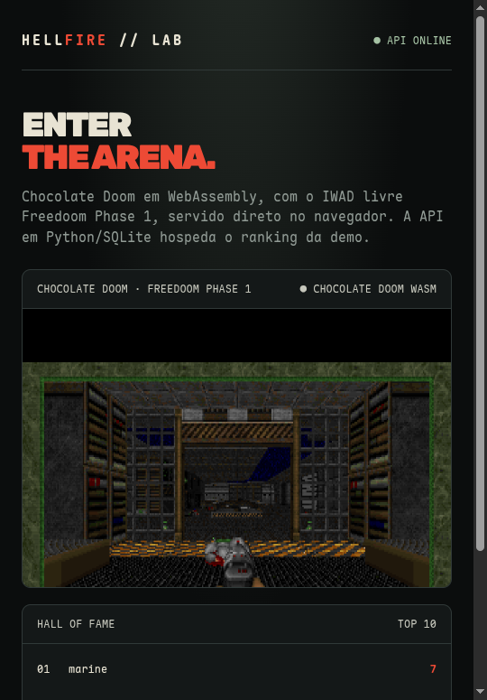

# HELLFIRE — Chocolate Doom no Azure

Chocolate Doom executado no navegador como WebAssembly, integrado a API REST em Python/Flask, persistência SQLite e infraestrutura Azure declarada em ARM. O WASM é compilado do submódulo upstream com Emscripten/SDL2. A página carrega automaticamente Freedoom Phase 1, um IWAD livre; nenhum WAD comercial é distribuído.


O Chocolate Doom entra automaticamente no primeiro mapa; use setas, Ctrl e Espaço para jogar. Captura do navegador incluída acima.

## Executar localmente

Clone com o submódulo upstream incluído: `git clone --recurse-submodules https://github.com/felipinhobgtom/hellfire-azure-doom.git`. Para desenvolvimento, instale Python 3.12+ e execute `pip install -r requirements.txt`. Nix é opcional para runtime/deploy; use `nix develop` e `./scripts/build_wasm.sh` para reconstruir o port com Emscripten/SDL2 e Freedoom. O pacote WASM compilado e IWAD já estão no repositório.

```bash
python app.py                # http://localhost:8000
```

Também pode executar o container sem Nix:

```bash
docker build -t hellfire .
docker run --rm -p 8000:8000 -v "$PWD/data:/data" hellfire
```


## API

| Método | Rota | Função |
|---|---|---|
| GET | `/api/health` | Verifica aplicação e SQLite |
| GET | `/api/scores` | Lista até 10 maiores pontuações |
| POST | `/api/scores` | Registra `{ "player": "marine", "kills": 7 }` |

`POST` retorna `201` com o registro salvo. Nome de jogador: 1–24 caracteres. Eliminações: inteiro de 0–999999. Erros de validação retornam `400`. O banco padrão é `data/doom.db`; configure outro caminho por `DATABASE_PATH`.

## Deploy Azure

Pré-requisitos: Azure CLI instalado em qualquer máquina (Nix é opcional) e permissões para criar grupo, VM, rede e Storage Account. O repositório já está publicado e a instância de demonstração está disponível em **[http://172.195.105.201](http://172.195.105.201)** (`Standard_B1s`, `mexicocentral`).

1. Autentique com `az login` (se necessário).
2. Defina uma senha forte para a VM: `export AZURE_VM_PASSWORD='...'`.
3. Execute `./deploy.sh` (região padrão `brazilsouth`; selecione com `AZURE_LOCATION`, SKU com `AZURE_VM_SIZE`). A assinatura estudantil atual permite `brazilsouth`, `mexicocentral`, `chilecentral`, `spaincentral` e `southcentralus`; valide as regiões/cotas da sua própria assinatura.
4. Aguarde cloud-init construir o container; teste `/api/health`.
5. Ao terminar a demonstração, rode `az group delete --name rg-hellfire-mexico --yes --no-wait` para remover os recursos e evitar cobranças.

O ARM cria VM Ubuntu 22.04 `Standard_B1s` por padrão (selecionável como `Standard_B2s`), disco SSD gerenciado Standard 30 GB, IP público IPv4, VNet/subnet, NSG liberando somente HTTP/80 e Storage Account privada Standard_LRS para boot diagnostics. A aplicação/gravações SQLite ficam no disco persistente da VM, **não** no blob. O endpoint é HTTP sem TLS e serve para demonstração; não exponha dados sensíveis. SSH é fechado pela NSG.

Consulte o guia completo, diagrama, esquema relacional e comandos no [`docs/relatorio.md`](docs/relatorio.md). Uma cópia PDF está em [`docs/relatorio.pdf`](docs/relatorio.pdf).

## Tecnologias

Python 3.12, Flask, SQLite, Gunicorn, Chocolate Doom 3.1.0, Emscripten/SDL2, Freedoom 0.13, Docker, Nix Flake, Azure ARM e Azure CLI. Chocolate Doom está incluído como submódulo GPL-2.0; conteúdo Freedoom sob BSD-3-Clause.
