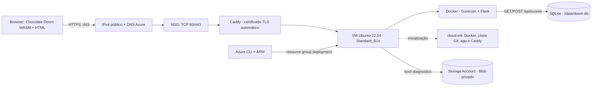
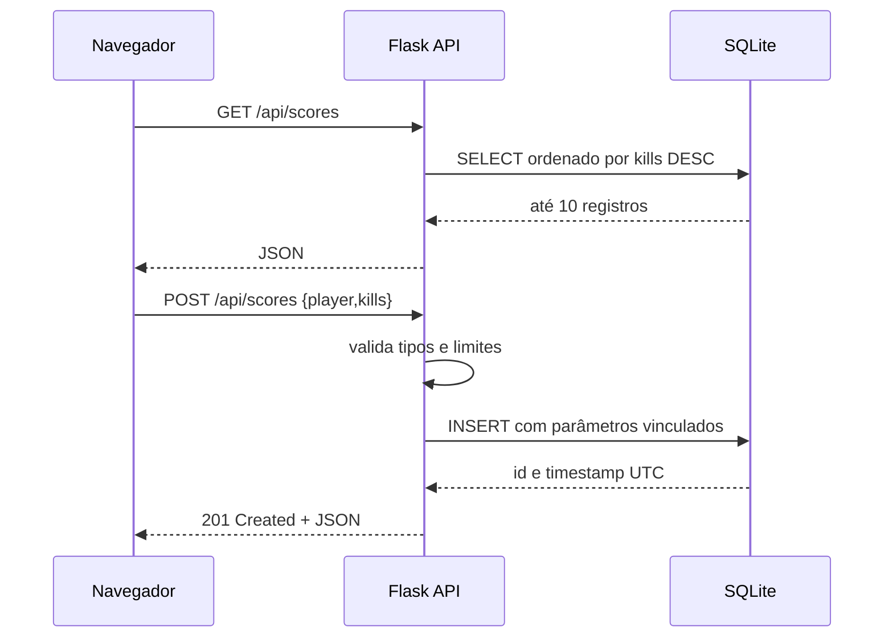
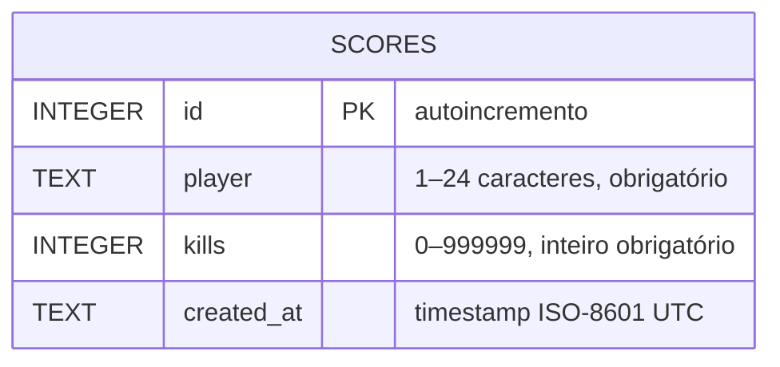

# Relatório técnico — HELLFIRE

**Aplicação web, API REST e implantação reproduzível no Microsoft Azure**  
Projeto didático · Novembro de 2026

## 1. Objetivo e escopo

Disponibilizar uma página que inicializa Chocolate Doom 3.1.0 como WebAssembly/SDL2 no navegador com o IWAD livre Freedoom Phase 1, expor uma API REST e persistir placares em SQLite. Toda a infraestrutura de demonstração é declarada por ARM e implantada com Azure CLI; Nix fornece um ambiente de desenvolvimento opcional.

O motor vem do submódulo upstream `midzer/chocolate-doom` (GPL-2.0) e os dados de jogo do release Freedoom 0.13.0 (BSD-3-Clause). Não são distribuídos IWADs comerciais de DOOM.

## 2. Arquitetura



### Fluxo de pontuação



Chocolate Doom e Freedoom são carregados automaticamente pela página. O SDL2/Emscripten recebe teclado e mouse diretamente no canvas; o elemento mantém o ID `canvas` exigido pelo backend de vídeo SDL Emscripten. A interface mostra o ranking da API; clientes registram resultados com `POST /api/scores`.

## 3. Banco de dados e contrato HTTP

### Modelo relacional



SQLite cria a tabela na primeira requisição. `PRAGMA journal_mode=WAL` melhora convivência entre leitores e o único worker Gunicorn. Restrições `CHECK` repetem no banco invariantes da aplicação. Escritas usam placeholders parametrizados.

| Operação | Corpo/exemplo | Sucesso | Falha |
|---|---|---|---|
| `GET /api/health` | — | `200 {"status":"ok","database":"sqlite"}` | `500` em falha de conexão |
| `GET /api/scores` | — | `200` lista (máximo 10) | `500` em falha de DB |
| `POST /api/scores` | `{"player":"marine","kills":7}` | `201` objeto persistido | `400` JSON inválido ou fora dos limites |

## 4. Componentes Azure

| Componente | Configuração | Papel e trade-off |
|---|---|---|
| Resource Group | `rg-hellfire-mexico`, localização `mexicocentral` | Grupo usado na implantação pública desta demonstração; `AZURE_RESOURCE_GROUP` e `AZURE_LOCATION` são configuráveis no script. |
| Máquina virtual | Ubuntu Server 22.04 Gen2, `Standard_B1s` (1 vCPU, 1 GiB RAM) | Host didático de baixo porte; suficiente para pouco tráfego e container leve, sem alta disponibilidade. Escolha `Standard_B2s` no parâmetro ARM se precisar de mais memória. SKU e preço variam por região/subscrição. |
| Disco OS | Standard SSD LRS, 30 GiB | Linux e persistência local `/opt/hellfire/data`; recurso gerenciado pelo Azure. SQLite num disco de instância única não escala horizontalmente. |
| Rede | VNet `10.10.0.0/16`, subnet `10.10.1.0/24`, NIC, IPv4 Standard estático e FQDN `hellfire-azure-doom-felipinhobgtom.mexicocentral.cloudapp.azure.com` | DNS público gerenciado pelo Azure e associado ao IP da demo; rótulo deve ser único na região. |
| NSG | Entrada TCP/80 e TCP/443 de Internet; SSH/22 não autorizado | HTTP serve o desafio ACME e redireciona para HTTPS; Caddy atende TLS em 443. |
| Proxy HTTPS | Caddy em container Docker, com `/data` e `/config` persistidos | Emite e renova certificado TLS automaticamente via ACME/Let's Encrypt; faz reverse proxy para Flask na rede Docker. |
| Storage Account | `StorageV2`, `Standard_LRS`, HTTPS obrigatório, TLS 1.2, acesso público a Blob desativado | Endpoint Blob associado a **boot diagnostics** da VM. Não é o datastore da aplicação nem backup do SQLite. |
| Cloud-init | apt instala Docker, clona Git, constrói imagem e executa app/Caddy | Bootstrap reproduzível; log em `/var/log/cloud-init-output.log`. |

`Standard_B1s` é SKU burstable de entrada e sujeito a disponibilidade/cota. O custo final depende da região, estado da VM, disco e preços da assinatura; uma VM ligada continua gerando custo. Remova o resource group após a aula. Esta configuração não promete nível gratuito.

## 5. Segurança e limites conhecidos

- HTTPS com certificado público automático via Caddy; HTTP redireciona para HTTPS. A demo ainda não tem login/autorização nem limitação de requisições; não enviar dados pessoais ou segredos.
- A UI sanitiza o nome ao renderizar; o servidor restringe nome/tipo/faixa e usa SQL parametrizado. O endpoint aceita qualquer pessoa, portanto pontuações não são autenticadas e podem ser forjadas.
- Senha da VM fornecida ao ARM como `secureString`, nunca gravada no template de parâmetros nem no git. SSH não é liberado no NSG.
- Container executa como UID não-root; DB é montado num diretório persistente da VM. A disponibilidade e backup dependem dessa VM. A Storage Account não contém os dados da aplicação.
- Uma réplica única de Flask com SQLite atende baixo volume; para crescimento, adotar armazenamento relacional gerenciado e serviço de aplicação compatível com estado/backup.
- CORS não é necessário: frontend e API são servidos pela mesma origem.
- Conteúdo de DOOM/IWAD e marcas/trademarks não são redistribuídos; a experiência atual é uma implementação independente.

## 6. Implantação passo a passo

### Pré-requisitos

Pré-requisitos para implantação: Azure CLI instalado em qualquer máquina (Linux, macOS, Windows/WSL ou Azure Cloud Shell), sessão/autorização Azure com permissões para criar VM, rede, IP e Storage, e cota disponível para SKU B-series. O código precisa estar em repositório GitHub **público** porque cloud-init clona a URL no bootstrap. GitHub CLI é usado apenas para publicar o repositório, não para implantar. Nix é opcional.

Esta assinatura de estudante permite somente `brazilsouth`, `mexicocentral`, `chilecentral`, `spaincentral` e `southcentralus`; verifique a política/cota da sua assinatura. Na tentativa de deploy, `Standard_B1s` e `Standard_B2s` estavam sem capacidade em Brazil South. O deploy público foi feito em `mexicocentral`, `Standard_B1s`, com o hostname `hellfire-azure-doom-felipinhobgtom.mexicocentral.cloudapp.azure.com`. Para outra conta, configure `AZURE_LOCATION`, `AZURE_VM_SIZE` e, se o rótulo estiver ocupado na região, `AZURE_DNS_LABEL`; a disponibilidade de capacidade muda.

### Publicar e deploy

```bash
# Opcional: publicar a partir da raiz do projeto
gh repo create hellfire-azure-doom --public --source=. --remote=origin --push

# Disponha az-cli no PATH e autentique (az login no workstation; Cloud Shell já autenticada)
az login
az account show
export AZURE_VM_PASSWORD='Senha-forte-que-atenda-a-politica'
export AZURE_DNS_LABEL='hellfire-azure-doom-felipinhobgtom' # opcional; o ARM usa este rótulo DNS
./deploy.sh
```

O script cria o grupo e chama `az deployment group create` com `infra/main.json` e `infra/parameters.json`. A saída apresenta `websiteUrl` (HTTPS), `dnsFqdn`, `publicIp`, `storageAccount` e `vmSize`. A VM inicia cloud-init, que sobe o proxy Caddy e solicita o certificado público; aguarde alguns minutos e então teste:

```bash
curl -fsS https://hellfire-azure-doom-felipinhobgtom.mexicocentral.cloudapp.azure.com/api/health
curl -fsS https://hellfire-azure-doom-felipinhobgtom.mexicocentral.cloudapp.azure.com/api/scores
curl -fsS -X POST https://hellfire-azure-doom-felipinhobgtom.mexicocentral.cloudapp.azure.com/api/scores \
  -H 'Content-Type: application/json' \
  -d '{"player":"marine","kills":7}'
```

Para obter o IP depois: `az vm list-ip-addresses -g "${AZURE_RESOURCE_GROUP:-rg-hellfire-demo}" -n hellfire-vm -o table`. Diagnóstico: `az vm boot-diagnostics get-boot-log -g "${AZURE_RESOURCE_GROUP:-rg-hellfire-demo}" -n hellfire-vm`; use console serial para inspeção. Remoção completa: `az group delete -n "${AZURE_RESOURCE_GROUP:-rg-hellfire-demo}" --yes --no-wait`. Para encerrar a demonstração publicada: `az group delete -n rg-hellfire-mexico --yes --no-wait`.

### CI/CD GitHub Actions

O workflow `.github/workflows/cicd.yml` roda em cada push e pull request para `main`: testes Flask/SQLite, checagem de sintaxe JavaScript/shell/JSON e build da imagem Docker. Push na branch `main` executa a entrega contínua após CI passar.

O job de deploy usa `azure/login@v2` com OIDC e `id-token: write`; não armazena client secret no GitHub. A credencial Entra confia no subject `repo:felipinhobgtom@39446516/hellfire-azure-doom@1451697932:ref:refs/heads/main` e tem `Virtual Machine Contributor` somente na VM. Em seguida, chama `az vm run-command invoke`, executa `scripts/deploy_vm.sh`, reconstrói o container na VM mantendo `/opt/hellfire/data` e reinicia o Caddy. O workflow valida a rota de health e o artefato WASM pelo hostname HTTPS.

Variáveis necessárias no repositório: `AZURE_CLIENT_ID`, `AZURE_TENANT_ID`, `AZURE_SUBSCRIPTION_ID`, `AZURE_RESOURCE_GROUP`, `AZURE_VM_NAME` e `AZURE_SITE_URL`.

## 7. Desenvolvimento/testes

```bash
nix develop                 # opcional: Python, Azure CLI, Emscripten e CMake
./scripts/build_wasm.sh    # recompila upstream + IWAD, requer submódulo clonado
python app.py              # http://localhost:8000
python -m unittest discover -s tests -v
```

A API usa SQLite embutido no Python. Em produção, Gunicorn executa um worker com quatro threads; Docker deriva de `python:3.12-slim`, e o caminho `/data` é montado para persistir o DB fora do container. O executável WASM e o pacote Freedoom já vêm no repositório, portanto rebuild local não é pré-requisito para executar ou implantar.

## 8. Organização do repositório

```text
app.py                    API Flask + SQLite
web/index.html            jogo WebAssembly em tela cheia
web/game.js               inicialização direta de Chocolate Doom
web/doom/                 artefatos JS/WASM/data do Chocolate Doom
web/assets/               IWAD Freedoom + licença
vendor/chocolate-doom/    submódulo upstream GPL-2.0
Dockerfile                imagem da aplicação
Caddyfile                 proxy HTTPS e reverse proxy
.github/workflows/cicd.yml CI e CD com GitHub Actions/OIDC
scripts/deploy_vm.sh      atualização da VM via Azure Run Command
deploy.sh                 orquestração inicial Azure CLI
infra/main.json           recursos ARM
infra/parameters.json     parâmetros sem credenciais
docs/relatorio.md         documentação completa
docs/relatorio.pdf        exportação para entrega
```

## 9. Evidências

1. [Captura da página em jogo](evidence-homepage.png), feita no Chromium com Freedoom Phase 1 em execução, sem página de apresentação.
2. A URL HTTPS apresentou certificado válido no Chromium/curl; a rota `/api/health` respondeu `200 {"database":"sqlite","status":"ok"}`. HTTP redireciona para HTTPS (`308`); JS, WASM e pacote de dados foram servidos pelo domínio.
3. A API respondeu `POST /api/scores` com `201` e `GET /api/scores` com o registro persistido. O deploy foi feito por ARM/Azure CLI; URL pública, SKU, região e recursos estão no README.
4. Para capturas do Portal Azure (Resource Group, VM, NSG, VNet e Storage), use sua sessão autenticada. Não inclua segredos em capturas.

## 10. Referências

- Microsoft Learn, ARM templates: https://learn.microsoft.com/azure/azure-resource-manager/templates/overview
- Microsoft Learn, Azure CLI: https://learn.microsoft.com/cli/azure/
- Microsoft Learn, VM sizes: https://learn.microsoft.com/azure/virtual-machines/sizes
- Chocolate Doom (referência de port, GPL): https://github.com/midzer/chocolate-doom
- SQLite: https://www.sqlite.org/docs.html
- Caddy, Automatic HTTPS: https://caddyserver.com/docs/automatic-https
