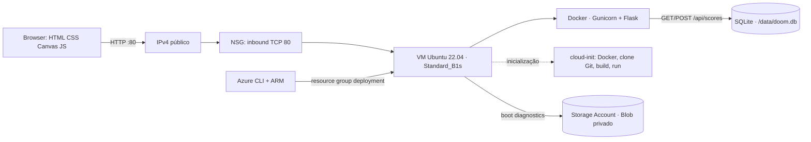
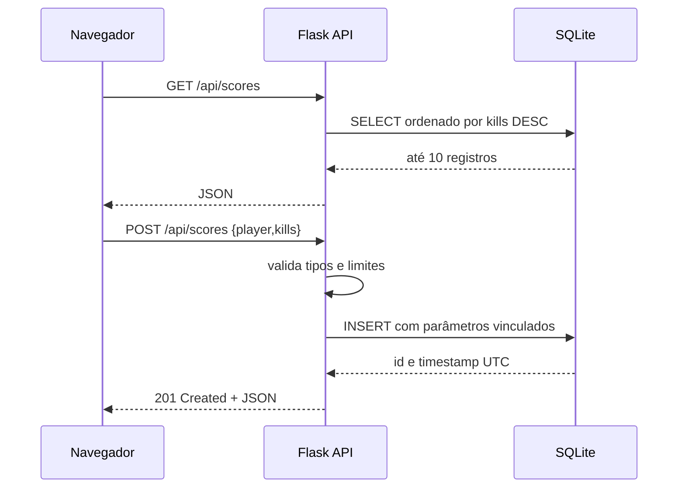
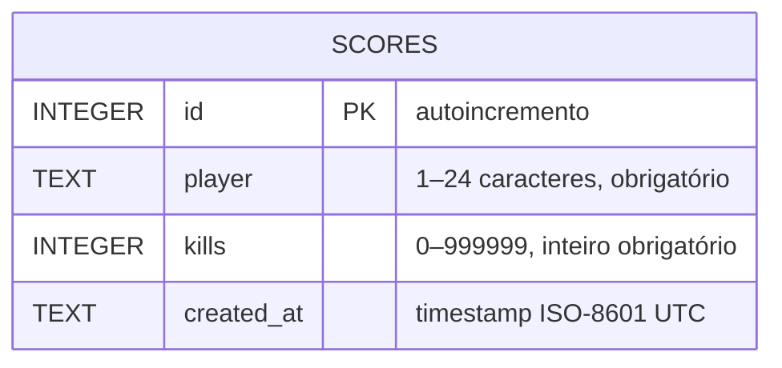

# Relatório técnico — HELLFIRE

**Aplicação web, API REST e implantação reproduzível no Microsoft Azure**  
Projeto didático · Novembro de 2026

## 1. Objetivo e escopo

Disponibilizar uma página web de entrada direta para uma arena FPS retrô, registrar resultados por uma API HTTP e armazená-los em banco relacional SQLite. Toda a infraestrutura de demonstração é criada por template Azure Resource Manager (ARM) e implantada com Azure CLI. O ambiente de desenvolvimento é definido por Nix Flakes.

**Precisão do protótipo:** o pedido inicial citou o port Chocolate Doom e WebAssembly. Esta entrega usa uma arena Canvas 2D própria e não é o executável Doom, não compila Chocolate Doom para WASM e não inclui WAD/IWAD. O upstream escolhido para futura integração é https://github.com/midzer/chocolate-doom. Para reproduzir o jogo original será preciso validar/adaptar SDL2/Emscripten, criar o pacote WASM e obter legalmente os dados do jogo. A UI não finge ser o port upstream.

## 2. Arquitetura



### Fluxo de pontuação



No protótipo atual a UI exibe o ranking e oferece a arena; a rota POST está disponível para integração de resultados. A persistência está ligada ao volume de dados Docker no disco gerenciado da VM.

## 3. Banco de dados e contrato HTTP

### Modelo relacional



SQLite cria a tabela na primeira requisição. `PRAGMA journal_mode=WAL` melhora convivência entre leitores e o único worker Gunicorn. Restrições `CHECK` repetem no banco invariantes da aplicação. Escritas usam placeholders parametrizados.

| Operação | Corpo/exemplo | Sucesso | Falha |
|---|---|---|---|
| `GET /api/health` | — | `200 {"status":"ok","database":"sqlite"}` | `500` em falha de conexão |
| `GET /api/scores` | — | `200` lista (máximo 10) | `500` em falha de DB |
| `POST /api/scores` | `{"player":"marine","kills":7}` | `201` objeto persistido | `400` JSON inválido ou fora dos limites |

## 4. Componentes Azure

| Componente | Configuração | Papel e trade-off |
|---|---|---|
| Resource Group | `rg-hellfire-demo`, localização `brazilsouth` | Ciclo de vida e remoção agrupados. |
| Máquina virtual | Ubuntu Server 22.04 Gen2, `Standard_B1s` (1 vCPU, 1 GiB RAM) | Host didático de baixo porte; suficiente para pouco tráfego e container leve, sem alta disponibilidade. Escolha `Standard_B2s` no parâmetro ARM se precisar de mais memória. SKU e preço variam por região/subscrição. |
| Disco OS | Standard SSD LRS, 30 GiB | Linux e persistência local `/opt/hellfire/data`; recurso gerenciado pelo Azure. SQLite num disco de instância única não escala horizontalmente. |
| Rede | VNet `10.10.0.0/16`, subnet `10.10.1.0/24`, NIC e IPv4 Standard estático | IP usado na URL resultante da implantação. |
| NSG | entrada TCP/80 de Internet; SSH/22 não autorizado | Menor superfície necessária para a demonstração. Administração via console serial/portal ou alteração controlada do NSG. |
| Storage Account | `StorageV2`, `Standard_LRS`, HTTPS obrigatório, TLS 1.2, acesso público a Blob desativado | Endpoint Blob associado a **boot diagnostics** da VM. Não é o datastore da aplicação nem backup do SQLite. |
| Cloud-init | apt instala Docker, clona Git, constrói imagem e executa container | Bootstrap reproduzível; log em `/var/log/cloud-init-output.log`. |

`Standard_B1s` é SKU burstable de entrada e sujeito a disponibilidade/cota. O custo final depende da região, estado da VM, disco e preços da assinatura; uma VM ligada continua gerando custo. Remova o resource group após a aula. Esta configuração não promete nível gratuito.

## 5. Segurança e limites conhecidos

- HTTP sem TLS, login/autorização e limitação de requisições; apenas para demo acadêmica. Não enviar dados pessoais ou segredos.
- A UI sanitiza o nome ao renderizar; o servidor restringe nome/tipo/faixa e usa SQL parametrizado. O endpoint aceita qualquer pessoa, portanto pontuações não são autenticadas e podem ser forjadas.
- Senha da VM fornecida ao ARM como `secureString`, nunca gravada no template de parâmetros nem no git. SSH não é liberado no NSG.
- Container executa como UID não-root; DB é montado num diretório persistente da VM. A disponibilidade e backup dependem dessa VM. A Storage Account não contém os dados da aplicação.
- Uma réplica única de Flask com SQLite atende baixo volume; para crescimento, adotar armazenamento relacional gerenciado e serviço de aplicação compatível com estado/backup.
- CORS não é necessário: frontend e API são servidos pela mesma origem.
- Conteúdo de DOOM/IWAD e marcas/trademarks não são redistribuídos; a experiência atual é uma implementação independente.

## 6. Implantação passo a passo

### Pré-requisitos

Pré-requisitos para implantação: Azure CLI instalado em qualquer máquina (Linux, macOS, Windows/WSL ou Azure Cloud Shell), sessão/autorização Azure com permissões para criar VM, rede, IP e Storage, e cota disponível para SKU B-series. O código precisa estar em repositório GitHub **público** porque cloud-init clona a URL no bootstrap. GitHub CLI é usado apenas para publicar o repositório, não para implantar. Nix é opcional.

### Publicar e deploy

```bash
# Opcional: publicar a partir da raiz do projeto
gh repo create hellfire-azure-doom --public --source=. --remote=origin --push

# Disponha az-cli no PATH e autentique (az login no workstation; Cloud Shell já autenticada)
az login
az account show
export AZURE_VM_PASSWORD='Senha-forte-que-atenda-a-politica'
./deploy.sh
```

O script cria o grupo e chama `az deployment group create` com `infra/main.json` e `infra/parameters.json`. A saída apresenta `websiteUrl`, `publicIp`, `storageAccount` e `vmSize`. A criação da VM inicia cloud-init; aguarde alguns minutos antes de testar:

```bash
curl -fsS http://IP_PUBLICO/api/health
curl -fsS http://IP_PUBLICO/api/scores
curl -fsS -X POST http://IP_PUBLICO/api/scores \
  -H 'Content-Type: application/json' \
  -d '{"player":"marine","kills":7}'
```

Para obter o IP depois: `az vm list-ip-addresses -g rg-hellfire-demo -n hellfire-vm -o table`. Diagnóstico: `az vm boot-diagnostics get-boot-log -g rg-hellfire-demo -n hellfire-vm`; use console serial para inspeção. Remoção completa: `az group delete -n rg-hellfire-demo --yes --no-wait`.

## 7. Desenvolvimento/testes

```bash
nix develop
python app.py
```

A API não precisa de dependência de banco externa: SQLite vem com Python. O servidor de produção é Gunicorn com um worker e quatro threads. Imagem Docker deriva de `python:3.12-slim`; o caminho `/data` é montado para persistir fora do container.

## 8. Organização do repositório

```text
app.py                 API Flask + SQLite
web/index.html         página responsiva
web/game.js            arena Canvas e placar
Dockerfile             imagem de produção
flake.nix              ambiente Nix reproduzível
deploy.sh              orquestração Azure CLI
infra/main.json        recursos ARM
infra/parameters.json  parâmetros sem credenciais
docs/relatorio.md      documentação completa
docs/relatorio.pdf     exportação para entrega
```

## 9. Evidências a anexar na apresentação

1. Página inicial aberta, arena visível e placar carregado.
2. Requisições `/api/health`, `GET /api/scores` e `POST /api/scores` com retorno HTTP.
3. Resource Group no Portal mostrando VM/SKU, IP, NSG, VNet e Storage Account.
4. URL pública funcionando e template ARM usado na implantação.

Capturas de tela devem ser feitas depois do deploy na assinatura do aluno e anexadas ao repositório/apresentação; não há capturas fabricadas ou recurso Azure ativo garantido pelo repositório.

## 10. Referências

- Microsoft Learn, ARM templates: https://learn.microsoft.com/azure/azure-resource-manager/templates/overview
- Microsoft Learn, Azure CLI: https://learn.microsoft.com/cli/azure/
- Microsoft Learn, VM sizes: https://learn.microsoft.com/azure/virtual-machines/sizes
- Chocolate Doom (referência de port, GPL): https://github.com/midzer/chocolate-doom
- SQLite: https://www.sqlite.org/docs.html
