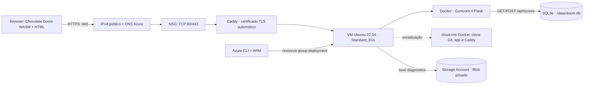
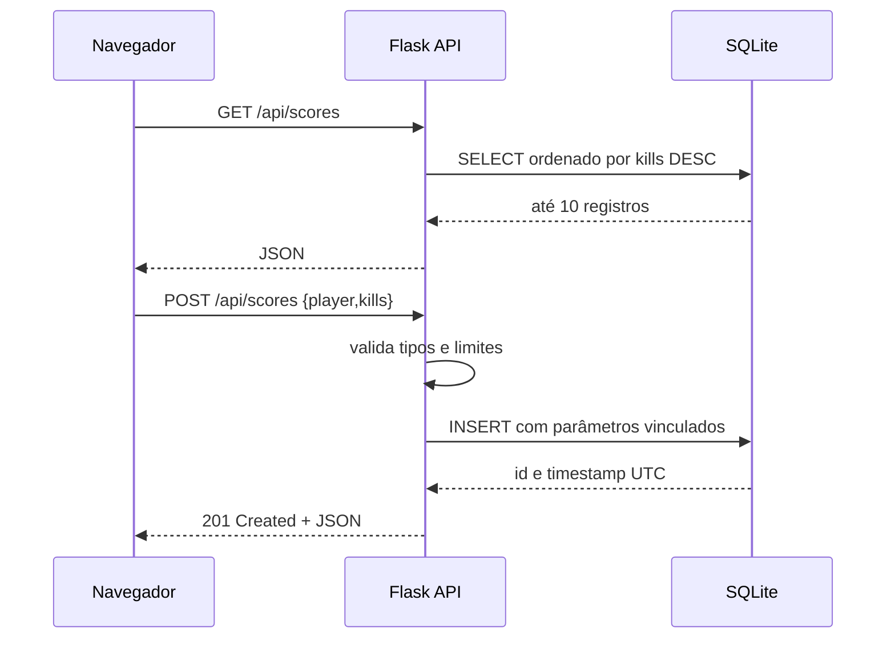
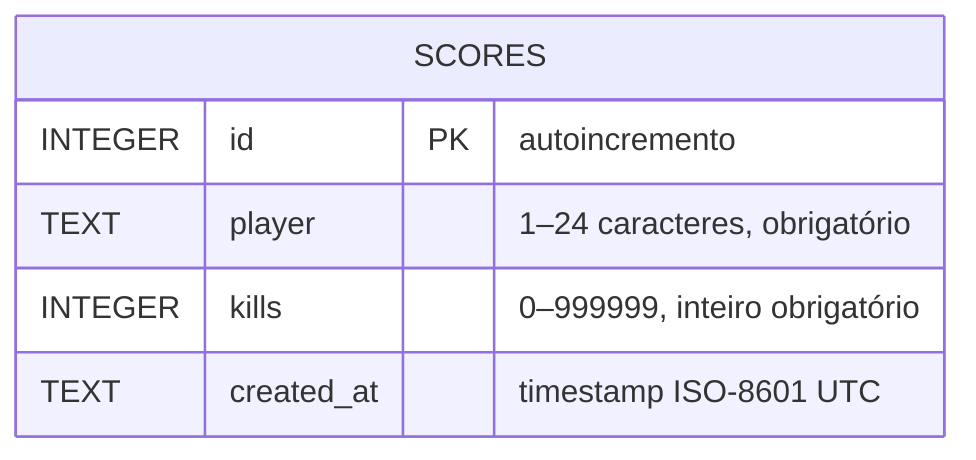
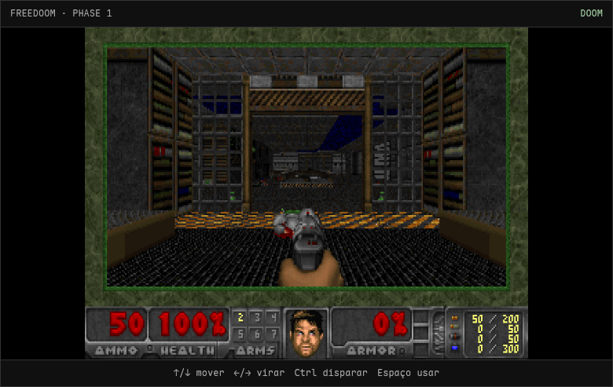

# Relatório técnico — HELLFIRE

**Aplicação web, API REST e implantação reproduzível no Microsoft Azure**  
Projeto didático · Novembro de 2026

## 1. Objetivo e escopo

Disponibilizar uma página que inicializa Chocolate Doom 3.1.0 como WebAssembly/SDL2 no navegador com o IWAD livre Freedoom Phase 1, expor uma API REST e persistir placares em SQLite. Toda a infraestrutura de demonstração é declarada por ARM e implantada com Azure CLI; Nix fornece um ambiente de desenvolvimento opcional.

O motor vem do submódulo upstream `midzer/chocolate-doom` (GPL-2.0) e os dados de jogo do release Freedoom 0.13.0 (BSD-3-Clause). Não são distribuídos IWADs comerciais de DOOM.

## 2. Arquitetura



### Fluxo de pontuação



Chocolate Doom e Freedoom são carregados automaticamente. Para capturar o mouse, o cliente solicita pointer lock em uma interação do usuário: clique no canvas ou use o botão de tela cheia, que também ativa fullscreen do navegador. O SDL2/Emscripten recebe teclado e mouse diretamente no canvas, que mantém o ID `canvas` exigido pelo backend de vídeo SDL.

## 3. Banco de dados e contrato HTTP

### Modelo relacional



SQLite cria a tabela na primeira requisição. `PRAGMA journal_mode=WAL` melhora convivência entre leitores e o único worker Gunicorn. Restrições `CHECK` repetem no banco invariantes da aplicação. Escritas usam placeholders parametrizados.

| Operação | Corpo/exemplo | Sucesso | Falha |
|---|---|---|---|
| `GET /api/health` | — | `200 {"status":"ok","database":"sqlite"}` | `500` em falha de conexão |
| `GET /api/scores` | — | `200` lista (máximo 10) | `500` em falha de DB |
| `POST /api/scores` | `{"player":"marine","kills":7}` | `201` objeto persistido | `400` JSON inválido ou fora dos limites |

## 4. Componentes Azure

| Componente | Configuração | Papel e trade-off |
|---|---|---|
| Resource Group | `rg-hellfire-mexico`, localização `mexicocentral` | Grupo usado na implantação pública desta demonstração; `AZURE_RESOURCE_GROUP` e `AZURE_LOCATION` são configuráveis no script. |
| Máquina virtual | Ubuntu Server 22.04 Gen2, `Standard_B1s` (1 vCPU, 1 GiB RAM) | Host didático de baixo porte; suficiente para pouco tráfego e container leve, sem alta disponibilidade. Escolha `Standard_B2s` no parâmetro ARM se precisar de mais memória. SKU e preço variam por região/subscrição. |
| Disco OS | Standard SSD LRS, 30 GiB | Linux e persistência local `/opt/hellfire/data`; recurso gerenciado pelo Azure. SQLite num disco de instância única não escala horizontalmente. |
| Rede | VNet `10.10.0.0/16`, subnet `10.10.1.0/24`, NIC, IPv4 Standard estático e FQDN `hellfire-azure-doom-felipinhobgtom.mexicocentral.cloudapp.azure.com` | DNS público gerenciado pelo Azure e associado ao IP da demo; rótulo deve ser único na região. |
| NSG | Entrada TCP/80 e TCP/443 de Internet; SSH/22 não autorizado | HTTP serve o desafio ACME e redireciona para HTTPS; Caddy atende TLS em 443. |
| Proxy HTTPS | Caddy em container Docker, com `/data` e `/config` persistidos | Emite e renova certificado TLS automaticamente via ACME/Let's Encrypt; faz reverse proxy para Flask na rede Docker. |
| Storage Account | `StorageV2`, `Standard_LRS`, HTTPS obrigatório, TLS 1.2, acesso público a Blob desativado | Endpoint Blob associado a **boot diagnostics** da VM. Não é o datastore da aplicação nem backup do SQLite. |
| Cloud-init | apt instala Docker, clona Git, constrói imagem e executa app/Caddy | Bootstrap reproduzível; log em `/var/log/cloud-init-output.log`. |

`Standard_B1s` é SKU burstable de entrada e sujeito a disponibilidade/cota. O custo final depende da região, estado da VM, disco e preços da assinatura; uma VM ligada continua gerando custo. Remova o resource group após a aula. Esta configuração não promete nível gratuito.

## 5. Segurança e limites conhecidos

- HTTPS com certificado público automático via Caddy; HTTP redireciona para HTTPS. A demo ainda não tem login/autorização nem limitação de requisições; não enviar dados pessoais ou segredos.
- A UI sanitiza o nome ao renderizar; o servidor restringe nome/tipo/faixa e usa SQL parametrizado. O endpoint aceita qualquer pessoa, portanto pontuações não são autenticadas e podem ser forjadas.
- Senha da VM fornecida ao ARM como `secureString`, nunca gravada no template de parâmetros nem no git. SSH não é liberado no NSG.
- Container executa como UID não-root; DB é montado num diretório persistente da VM. A disponibilidade e backup dependem dessa VM. A Storage Account não contém os dados da aplicação.
- Uma réplica única de Flask com SQLite atende baixo volume; para crescimento, adotar armazenamento relacional gerenciado e serviço de aplicação compatível com estado/backup.
- CORS não é necessário: frontend e API são servidos pela mesma origem.
- Conteúdo de DOOM/IWAD e marcas/trademarks não são redistribuídos; a experiência atual é uma implementação independente.

## 6. Implantação passo a passo com ARM + Azure CLI

Este procedimento cria uma cópia própria do projeto na sua assinatura Azure. Funciona em Windows PowerShell e Linux Bash e usa a Azure CLI para enviar diretamente o template ARM público; não requer Nix, Docker local, Git ou GitHub CLI. Durante o bootstrap, a VM clona o repositório público. Não use este caminho para código privado sem alterar a estratégia de acesso do template.

### 6.1 Pré-requisitos e custos

- Azure CLI instalado: [Windows](https://learn.microsoft.com/cli/azure/install-azure-cli-windows) ou [Linux](https://learn.microsoft.com/cli/azure/install-azure-cli-linux).
- Assinatura Azure ativa, sessão autenticada e autorização para criar Resource Group, VM, rede/IP público e Storage Account.
- Cota/capacidade regional para `Standard_B1s` (padrão) ou `Standard_B2s`; ambos são os únicos tamanhos aceitos pelo ARM atual.
- Senha forte para a conta local `azureuser`: mínimo de 12 caracteres com maiúscula, minúscula, número e símbolo. O parâmetro é `secureString`; o NSG não libera SSH.
- Acesso à Internet para Azure e ao repositório público GitHub.

Recursos ligados podem gerar custos por hora, disco e rede. Não existe garantia de nível gratuito. Preços/cotas dependem da região e assinatura; consulte a [calculadora de preços do Azure](https://azure.microsoft.com/pricing/calculator/) antes do deploy. Ao terminar, exclua o grupo de recursos criado.

### 6.2 Autenticar e escolher a assinatura

Execute no PowerShell ou Bash:

```text
az login
az account list --output table
az account set --subscription "<ID-OU-NOME-DA-SUBSCRICAO>"
az account show --output table
```

Em Azure Cloud Shell, a sessão costuma já estar autenticada. Confira a assinatura ativa antes de criar recursos.

### 6.3 Enviar o template ARM

O template está em `infra/main.json` e também pode ser buscado diretamente do branch `main`. Ele recebe `adminPassword` como segredo, `repositoryUrl` público, `dnsLabel` exclusivo e `vmSize`. O Resource Group determina a localização; o nome padrão da VM é `hellfire-vm`. O rótulo DNS deve ser único; se Azure rejeitar, gere outro e execute novamente.

#### Windows — PowerShell

```powershell
$ResourceGroup = "rg-hellfire-demo"
$Location = "brazilsouth"
$DnsLabel = "hellfire-doom-$((Get-Random -Minimum 10000 -Maximum 99999))"
$TemplateUri = "https://raw.githubusercontent.com/felipinhobgtom/hellfire-azure-doom/main/infra/main.json"
$RepositoryUrl = "https://github.com/felipinhobgtom/hellfire-azure-doom.git"

az group create --name $ResourceGroup --location $Location --output table

$SecurePassword = Read-Host "Senha forte para azureuser" -AsSecureString
$VmPassword = [System.Net.NetworkCredential]::new("", $SecurePassword).Password
$WebsiteUrl = az deployment group create `
  --resource-group $ResourceGroup `
  --name ("hellfire-" + (Get-Date -Format "yyyyMMddHHmmss")) `
  --template-uri $TemplateUri `
  --parameters "adminPassword=$VmPassword" "repositoryUrl=$RepositoryUrl" "dnsLabel=$DnsLabel" "vmSize=Standard_B1s" `
  --query "properties.outputs.websiteUrl.value" --output tsv
if ($LASTEXITCODE -ne 0) { throw "O deploy ARM falhou; consulte a mensagem do Azure." }
$VmPassword = $null
$SecurePassword = $null
Write-Host "URL do jogo: $WebsiteUrl"
```

#### Linux — Bash

```bash
set -euo pipefail
RESOURCE_GROUP="rg-hellfire-demo"
LOCATION="brazilsouth"
DNS_LABEL="hellfire-doom-$RANDOM-$RANDOM"
TEMPLATE_URI="https://raw.githubusercontent.com/felipinhobgtom/hellfire-azure-doom/main/infra/main.json"
REPOSITORY_URL="https://github.com/felipinhobgtom/hellfire-azure-doom.git"

az group create --name "$RESOURCE_GROUP" --location "$LOCATION" --output table

read -r -s -p "Senha forte para azureuser: " VM_PASSWORD
printf '\n'
WEBSITE_URL="$(az deployment group create \
  --resource-group "$RESOURCE_GROUP" \
  --name "hellfire-$(date +%Y%m%d%H%M%S)" \
  --template-uri "$TEMPLATE_URI" \
  --parameters "adminPassword=$VM_PASSWORD" "repositoryUrl=$REPOSITORY_URL" "dnsLabel=$DNS_LABEL" "vmSize=Standard_B1s" \
  --query 'properties.outputs.websiteUrl.value' --output tsv)"
unset VM_PASSWORD
printf 'URL do jogo: %s\n' "$WEBSITE_URL"
```

Os comandos usam `brazilsouth` como exemplo. Se sua assinatura não tiver cota/capacidade nessa região, liste as localidades permitidas com `az account list-locations --output table` e escolha outra. Se `Standard_B1s` não estiver disponível, tente `Standard_B2s` alterando `vmSize` no comando. Se o rótulo DNS já estiver ocupado, gere outro `DnsLabel`/`DNS_LABEL`. Ambos os parâmetros são definidos no template.

O ARM retorna `websiteUrl`, `dnsFqdn`, `publicIp`, `storageAccount` e `vmSize`. O exemplo seleciona `websiteUrl` e o imprime no final. Esse é o link HTTPS a abrir; não presuma o hostname de outra implantação.

### 6.4 Aguardar o bootstrap e validar

O deployment ARM cria os recursos, mas o cloud-init da VM continua em seguida: instala Docker/Git, clona o repositório, constrói/ativa os containers e configura Caddy. Aguarde alguns minutos; a primeira solicitação TLS depende da propagação DNS e da porta 80 pública.

Linux:

```bash
curl --fail --show-error "$WEBSITE_URL/api/health"
curl --fail --show-error --output /dev/null "$WEBSITE_URL/doom/chocolate-doom.wasm"
```

Windows PowerShell:

```powershell
Invoke-RestMethod "$WebsiteUrl/api/health"
Invoke-WebRequest "$WebsiteUrl/doom/chocolate-doom.wasm" -Method Head
Start-Process $WebsiteUrl
```

O health check deve responder `status: ok`; o WASM deve responder HTTP 200. Caddy emite e renova certificado TLS automaticamente, e HTTP redireciona para HTTPS. A captura da tela do jogo está na seção Evidências e no README.

### 6.5 Recursos provisionados

| Componente | Configuração | Função |
|---|---|---|
| VM | Ubuntu Server 22.04 Gen2, `Standard_B1s`, disco Standard SSD 30 GB | Hospeda Docker, Flask/Gunicorn/SQLite e Caddy |
| Rede pública | IPv4 Standard estático, DNS Azure, VNet/subnet/NIC | Publica o hostname do site |
| NSG | TCP/80 e TCP/443 de Internet; sem TCP/22 | Desafio/redirecionamento HTTP e HTTPS; SSH permanece fechado |
| Storage Account | `Standard_LRS`, TLS 1.2, Blob privado | Boot diagnostics da VM, não banco da aplicação |
| Persistência | SQLite em `/opt/hellfire/data` no disco VM | Banco local da API; não é backup/alta disponibilidade |

### 6.6 Diagnóstico sem abrir SSH

Se o site não responder após alguns minutos, verifique DNS, capacidade do SKU e regras TCP/80/443. O log cloud-init pode ser obtido com Run Command:

```text
az vm run-command invoke --resource-group rg-hellfire-demo --name hellfire-vm --command-id RunShellScript --scripts "tail -n 100 /var/log/cloud-init-output.log" --query "value[0].message" --output tsv
```

Use o mesmo comando no PowerShell e Bash. Também é possível consultar o boot diagnostics no Azure Portal. O Resource Group deve continuar contendo a VM e os recursos até o diagnóstico terminar.

### 6.7 Remover a implantação

Execute somente após guardar o que precisar. O comando exclui permanentemente **todos** os recursos dentro do grupo:

```text
az group delete --name rg-hellfire-demo --yes --no-wait
```

Substitua o nome se escolheu outro grupo. `rg-hellfire-demo` é o exemplo desta documentação; `rg-hellfire-mexico` é a infraestrutura da demonstração pública e não deve ser removida para limpar sua cópia.

### CI/CD GitHub Actions

O workflow `.github/workflows/cicd.yml` roda em cada push e pull request para `main`: testes Flask/SQLite, checagem de sintaxe JavaScript/shell/JSON e build da imagem Docker. Push na branch `main` executa a entrega contínua após CI passar.

O job de deploy usa `azure/login@v2` com OIDC e `id-token: write`; não armazena client secret no GitHub. A credencial Entra confia no subject `repo:felipinhobgtom@39446516/hellfire-azure-doom@1451697932:ref:refs/heads/main` e tem `Virtual Machine Contributor` somente na VM. Em seguida, chama `az vm run-command invoke`, executa `scripts/deploy_vm.sh`, reconstrói o container na VM mantendo `/opt/hellfire/data` e reinicia o Caddy. O workflow valida a rota de health e o artefato WASM pelo hostname HTTPS.

Variáveis necessárias no repositório: `AZURE_CLIENT_ID`, `AZURE_TENANT_ID`, `AZURE_SUBSCRIPTION_ID`, `AZURE_RESOURCE_GROUP`, `AZURE_VM_NAME` e `AZURE_SITE_URL`.

## 7. Desenvolvimento/testes

```bash
nix develop                 # opcional: Python, Azure CLI, Emscripten e CMake
./scripts/build_wasm.sh    # recompila upstream + IWAD, requer submódulo clonado
python app.py              # http://localhost:8000
python -m unittest discover -s tests -v
```

A API usa SQLite embutido no Python. Em produção, Gunicorn executa um worker com quatro threads; Docker deriva de `python:3.12-slim`, e o caminho `/data` é montado para persistir o DB fora do container. O executável WASM e o pacote Freedoom já vêm no repositório, portanto rebuild local não é pré-requisito para executar ou implantar.

## 8. Organização do repositório

```text
app.py                    API Flask + SQLite
web/index.html            jogo WebAssembly em tela cheia
web/game.js               inicialização direta de Chocolate Doom
web/doom/                 artefatos JS/WASM/data do Chocolate Doom
web/assets/               IWAD Freedoom + licença
vendor/chocolate-doom/    submódulo upstream GPL-2.0
Dockerfile                imagem da aplicação
Caddyfile                 proxy HTTPS e reverse proxy
.github/workflows/cicd.yml CI e CD com GitHub Actions/OIDC
scripts/deploy_vm.sh      atualização da VM via Azure Run Command
deploy.sh                 orquestração inicial Azure CLI
infra/main.json           recursos ARM
infra/parameters.json     parâmetros sem credenciais
docs/relatorio.md         documentação completa
docs/relatorio.pdf        exportação para entrega
```

## 9. Evidências

1. Captura real do jogo após o deploy:

2. A URL HTTPS apresentou certificado válido no Chromium/curl; `/api/health` respondeu `200 {"database":"sqlite","status":"ok"}`. HTTP redireciona para HTTPS (`308`); JS, WASM e pacote de dados foram servidos pelo domínio.
3. A API respondeu `POST /api/scores` com `201` e `GET /api/scores` com o registro persistido. O deploy foi feito por ARM/Azure CLI; URL, SKU, região e recursos estão no README.
4. Para capturas do Portal Azure (Resource Group, VM, NSG, VNet e Storage), use sua sessão autenticada. Não inclua segredos em capturas.

## 10. Referências

- Microsoft Learn, ARM templates: https://learn.microsoft.com/azure/azure-resource-manager/templates/overview
- Microsoft Learn, Azure CLI: https://learn.microsoft.com/cli/azure/
- Microsoft Learn, VM sizes: https://learn.microsoft.com/azure/virtual-machines/sizes
- Chocolate Doom (referência de port, GPL): https://github.com/midzer/chocolate-doom
- SQLite: https://www.sqlite.org/docs.html
- Caddy, Automatic HTTPS: https://caddyserver.com/docs/automatic-https
